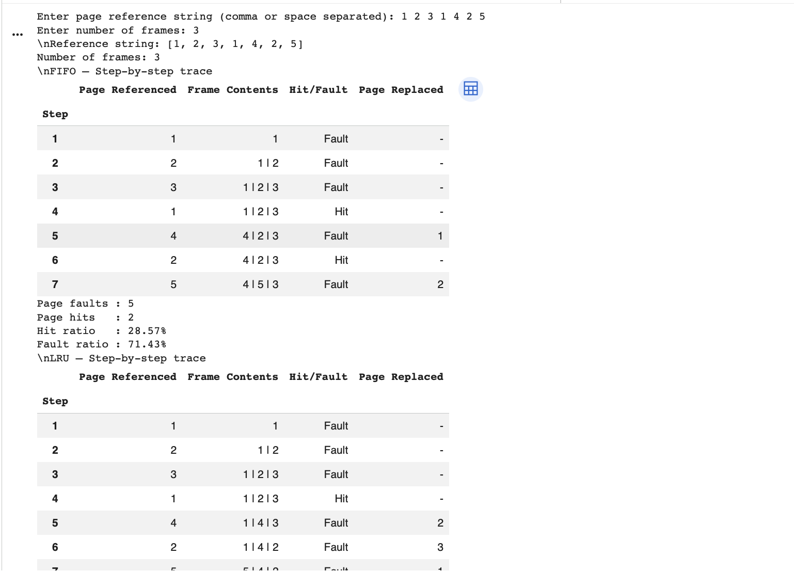
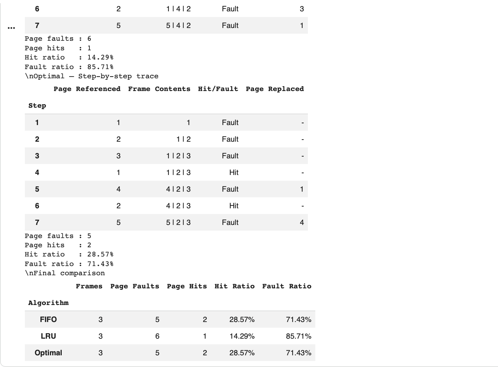
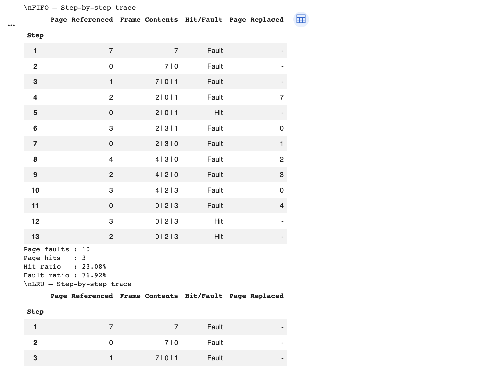
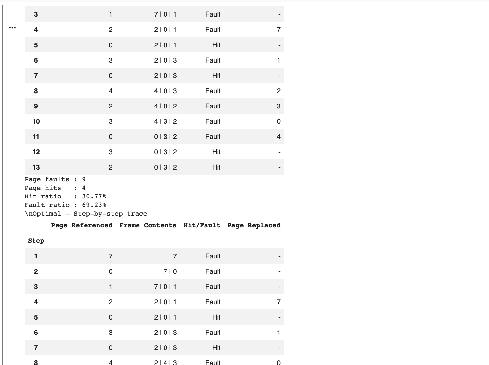
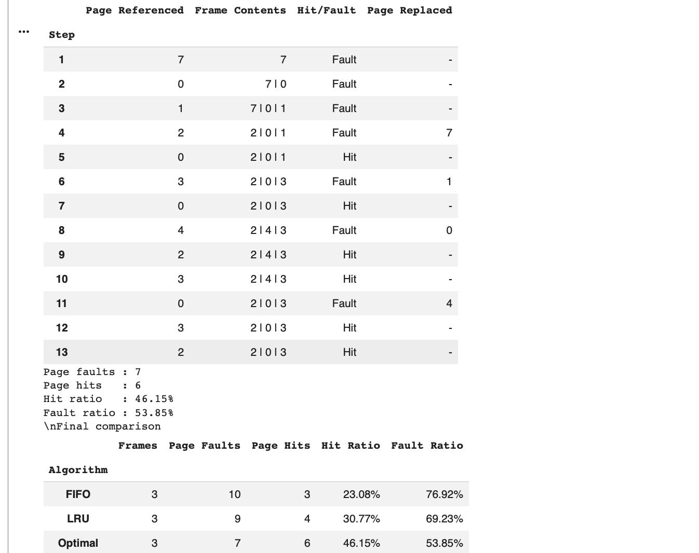
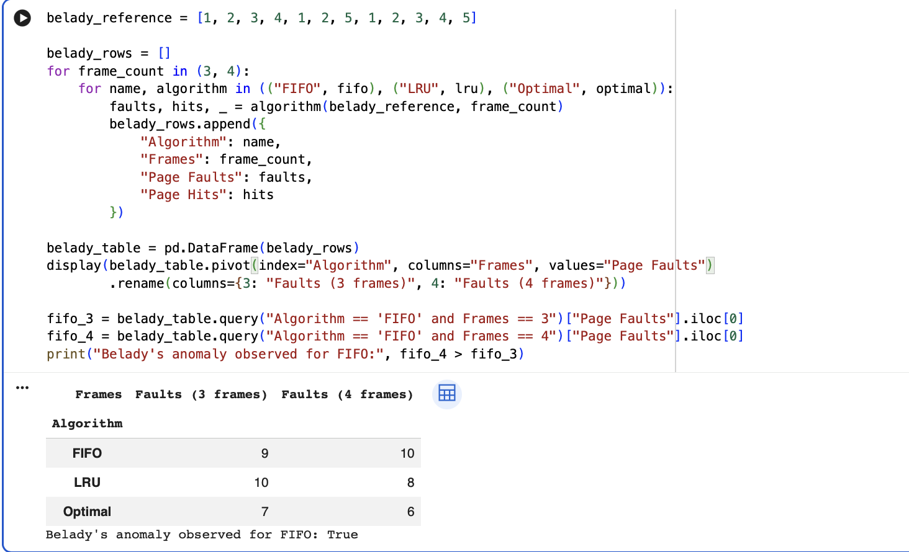
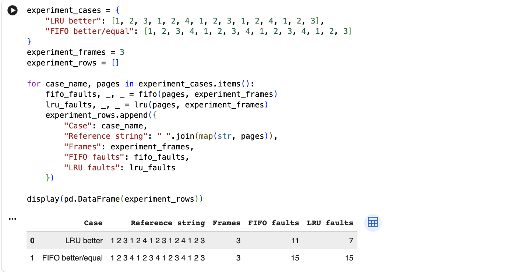

# 🖥️ Page Replacement Algorithm Simulator

### Operating Systems | Virtual Memory Management | Python

A Python-based simulation of three classical page replacement algorithms — **FIFO, LRU, and Optimal** — designed to demonstrate how operating systems manage pages in memory and handle page faults.


---

## 📌 Project Overview

In a demand-paging system, only a limited number of pages can reside in physical memory at a time. When a requested page is not available in memory, a **page fault** occurs. If all available frames are occupied, the operating system must replace an existing page to load the requested one.

This project implements and compares three page replacement strategies to understand their behavior, replacement decisions, and performance.

## 🎯 Objectives

- Implement FIFO, LRU, and Optimal page replacement algorithms.
- Process a page-reference string using a specified number of frames.
- Display step-by-step page replacement decisions.
- Calculate page faults, page hits, hit ratio, and fault ratio.
- Compare algorithm performance using common test cases.
- Demonstrate Belady's anomaly using FIFO.

## ⚙️ Algorithms Implemented

| Algorithm | Full Form | Replacement Strategy |
|---|---|---|
| FIFO | First-In, First-Out | Replaces the page that entered memory earliest. |
| LRU | Least Recently Used | Replaces the page that has not been used for the longest time. |
| Optimal | Optimal Page Replacement | Replaces the page whose next use is farthest in the future, or which will not be used again. |

### 1. FIFO (First-In, First-Out)

FIFO maintains the order in which pages enter memory. When a replacement is required, the oldest loaded page is removed.

### 2. LRU (Least Recently Used)

LRU tracks previous page usage and replaces the page that has remained unused for the longest time.

### 3. Optimal Page Replacement

Optimal uses future page references to select the page whose next use is farthest away. It provides a theoretical benchmark for the minimum number of page faults, but requires future knowledge that is generally unavailable to a real operating system.

## ✨ Key Features

- **Three algorithms:** FIFO, LRU, and Optimal.
- **Step-by-step trace:** Displays page references, frame contents, hit/fault status, and replaced pages.
- **Input validation:** Checks page-reference values and frame counts.
- **Performance comparison:** Summarizes page faults, hits, and relevant ratios.
- **Belady's anomaly experiment:** Investigates whether increasing frame count increases FIFO page faults for a selected reference string.
- **Jupyter Notebook:** Provides an interactive environment for running code and viewing results.
- **Python source file:** Includes the extracted source code for inspection and further development.

## 🛠️ Technology Stack

- **Language:** Python 3
- **Environment:** Jupyter Notebook
- **Library:** Pandas
- **Tools:** Google Colab / Jupyter Notebook, Git, GitHub

## 📂 Project Structure

```text
page-replacement-algorithm-simulator/
│
├── screenshots/
│   └── README.md
│
├── BTE25DTA000013_Deep_Dwivedi_PageReplacement.ipynb
├── page_replacement_simulator.py
├── Page_Replacement_Project_Report.pdf
└── README.md
```

*Note: The filenames above should match the files actually present in the repository. Rename or update the notebook and report entries if your uploaded filenames differ.*

## 🚀 Getting Started

### Prerequisites

Install Python 3 and use Jupyter Notebook or Google Colab.

If running locally, install Pandas:

```bash
python3 -m pip install pandas
```

### Option 1: Run in Google Colab

1. Open the project notebook (`.ipynb`).
2. Upload it to Google Colab or open it from your Google Drive.
3. Run the notebook cells in order.
4. Enter the required page-reference string and number of frames when prompted.
5. Review the traces, algorithm comparisons, and experiment results.

### Option 2: Run Locally

Clone the repository:

```bash
git clone https://github.com/deepdwivedi12/page-replacement-algorithm-simulator.git
```

Navigate to the project directory:

```bash
cd page-replacement-algorithm-simulator
```

Launch Jupyter Notebook:

```bash
python3 -m pip install notebook pandas
python3 -m notebook
```

Open the project's `.ipynb` file in the Jupyter interface and execute the cells in order.

**Note:** The extracted Python file may contain notebook-specific `display()` calls. The notebook is the recommended execution method unless those calls have been adapted for terminal output.

## 🧪 Sample Input

```text
Page reference string: 7 0 1 2 0 3 0 4 2 3 0 3 2
Number of frames: 3
```

The simulator processes the same reference string using FIFO, LRU, and Optimal and reports the resulting page hits and faults.

### Performance Metrics

- **Page Faults:** Number of references that require loading a page into memory.
- **Page Hits:** Number of references where the requested page is already present.
- **Hit Ratio:** Percentage of references resulting in page hits.
- **Fault Ratio:** Percentage of references resulting in page faults.

Formulas:

```text
Hit Ratio = (Page Hits / Total References) × 100

Fault Ratio = (Page Faults / Total References) × 100
```

The exact results depend on the reference string, frame count, and algorithm.

## 📊 Experiments

### Algorithm Comparison

The project compares FIFO, LRU, and Optimal using the same reference string and frame count to illustrate how replacement policies affect page faults.

### Belady's Anomaly

Belady's anomaly occurs when increasing the number of memory frames increases the number of page faults. FIFO can exhibit this behavior for certain reference strings, while stack algorithms such as LRU and Optimal do not exhibit this anomaly under the standard model.

## 📸 Screenshots

Execution screenshots can be added to the `screenshots/` directory to document:

- Step-by-step page replacement traces
- FIFO, LRU, and Optimal comparisons
- Belady's anomaly experiment
- Final performance summary

Once uploaded, link the actual image files here using Markdown:

```markdown

```

## 📄 Project Report

The detailed project report covers the introduction, objectives, algorithms, methodology, implementation, sample results, Belady's anomaly, and conclusion.

**Report file:** `Page_Replacement_Project_Report.pdf`

## 🎓 Learning Outcomes

Through this project, I explored:

- Virtual memory and demand paging
- Page faults and page hits
- Memory frame management
- FIFO, LRU, and Optimal replacement strategies
- Algorithm comparison and performance metrics
- Belady's anomaly
- Python implementation and experimentation using Jupyter Notebook

## 🔮 Future Improvements

- Add a graphical user interface for interactive simulations.
- Visualize frame changes with animations.
- Add more replacement algorithms, such as LFU and Second Chance.
- Display charts comparing page faults across different frame counts.
- Improve the simulator with automated test cases and performance analysis.

## 👨‍💻 Author

**Deep Dwivedi**

B.Tech — Computer Science and Engineering (Data Analytics)

Enrollment Number: `BTE25DTA000013`

GitHub: [@deepdwivedi12](https://github.com/deepdwivedi12)

## 📜 License

This project was developed for educational and academic purposes. A formal open-source license can be added if the project is intended for redistribution.

---

⭐ If you find this project useful for learning operating systems and virtual memory concepts, consider starring the repository.
## 📸 Execution Screenshots

### 1. Experiment Output


### 2. Algorithm Results


### 3. Execution Trace


### 4. Page Replacement Results


### 5. Performance Comparison


### 6. Belady's Anomaly


### 7. Final Results


## 📄 Project Report

[**View / Download Project Report (PDF)**](Deep_Dwivedi_Page_Replacement_Project_Report.pdf)
